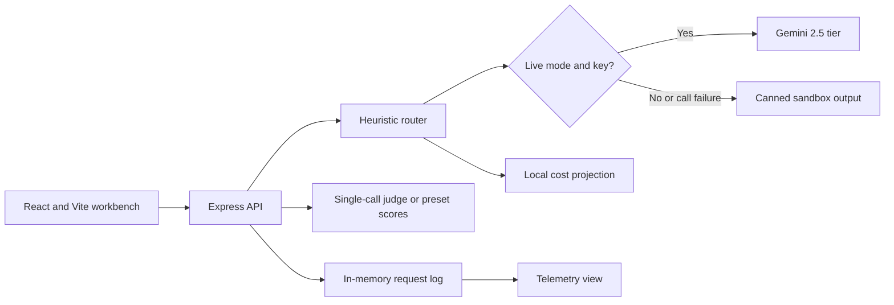

# CascadeEval

**An LLM routing and evaluation prototype for exploring response quality, latency, and inference cost.**

Route a prompt across Gemini tiers, inspect the decision, compare candidate answers, and model the economics before committing to an architecture.

[Try the deployed sandbox](https://cascadeeval.ai.studio/) · [Routing implementation](server.ts) · [Cost model](src/utils/finopsMath.ts)

**Status:** Portfolio prototype built in Google AI Studio. Sandbox mode is the default; live Gemini inference is optional. Demo figures are not validated production benchmarks.

## The product question

When can a cheaper model handle a request, and what evidence would justify escalation? CascadeEval makes that decision inspectable through a complexity score, tier selection, projected cost, and candidate comparison.

## Explore the workflow

1. In **Router Playground**, choose a preset or enter a prompt. Inspect the five complexity factors and selected tier.
2. Compare a compact extraction request with a harder reasoning request. The heuristic can misroute either; its score is not a quality guarantee.
3. Send a result to the **Pairwise Autorater** and supply a comparison answer. Candidate B starts as an editable example, rather than a freshly generated frontier answer.
4. Use the **FinOps Calculator** to vary traffic mix, tokens, and cache-hit assumptions. Treat savings as a scenario.
5. In **Telemetry**, inspect recent requests or seed synthetic records with the batch action.

## What is implemented

| Capability | Current behavior |
| --- | --- |
| Routing | Rule-based score from reasoning keywords, domain terms, constraints, lexical diversity, and estimated tokens; thresholds select one of three tiers. |
| Live generation | With a server-side key **and Live Gemini Mode enabled**, calls `gemini-2.5-flash-lite`, `gemini-2.5-flash`, or `gemini-2.5-pro`. |
| Candidate judging | One optional Gemini 2.5 Pro call scores two supplied answers on grounding, instructions, coherence, and safety. |
| Economics | Local formulas project per-request and blended costs from configured prices and token assumptions. |
| Request log | In-memory rolling telemetry, including simulated requests; up to 100 records, reset on server restart. |

### Read the results correctly

- **Sandbox:** Canned responses with randomized latency. Missing credentials or failed live generation also lead to sandbox output. Check `result.isSimulated` in the route response.
- **Judge bias:** The UI displays two presentation orders, but the server copies the first winner into the second result. No independent swapped-order call runs, so the display does not establish absence of position bias. Failed live judging can retain preset scores and a live-looking model label.
- **Model labels:** Some UI labels say Gemini 3.5 Flash / 3.1 Pro; actual live requests use the Gemini 2.5 IDs above. Prices and latency presets in [`MODEL_TIERS`](src/types/gateway.ts) are static assumptions.
- **Latency:** Successful live generation duration is timed on the server. Time to first token is estimated from that duration; generation does not stream. Sandbox latency and historical accuracy/P95/P99 charts are illustrative.
- **Cost:** Input tokens are estimated from characters; output tokens are fixed for the projection. Even `actualCostUsd` is modeled, rather than provider billing or usage metadata.
- **Caching and context limits:** SHA-256 fingerprints are computed, but cache hits and discounts are simulated. The context-cliff guard changes accounting values; it does not truncate the context sent to Gemini or create a provider cache.
- **Recovery and batch:** UI toggles simulate rate-limit/schema fallback decisions. Retry/backoff, a circuit breaker, schema-validation recovery, and provider Batch API jobs are not implemented. Async-batch mode changes cost assumptions.

No measured routing accuracy, quality parity, or realized cost reduction is claimed. UI terms such as “GA,” “enterprise,” and “FLAMe-aligned” describe prototype intent, rather than a production release or external validation.

## Architecture



| Endpoint | Purpose |
| --- | --- |
| `POST /api/gateway/route` | Routing decision and live or simulated output. |
| `POST /api/gateway/autorate` | Compare two supplied candidates with live or preset scores. |
| `GET /api/gateway/stats` | Aggregate the in-memory log; demo defaults when empty. |
| `POST /api/gateway/simulate-batch` | Add synthetic sample requests. |

## Run locally

Checked with Node.js 24 and npm 11. The current manifest has a Vite/esbuild peer conflict; skipping peer resolution also leaves Recharts' `react-is` peer missing. This temporary local install gets the existing source running without changing dependency files:

```bash
git clone https://github.com/aaryanvani-PM/CascadeEval.git
cd CascadeEval
npm install --legacy-peer-deps --no-save --package-lock=false react-is@19
npm run dev
```

Open `http://localhost:3000`. No key is needed for sandbox mode.

For live generation, copy `.env.example` to `.env`, replace `MY_GEMINI_API_KEY` with your own key, restart, and enable **Live Gemini Mode** using the top-right toggle. Leave the key unset for sandbox use; the example value is a placeholder. Keep `.env` out of Git. Live calls use your provider quota. The route endpoint has an in-memory 25-per-hour IP-based quota; the judge endpoint does not share that limiter.

```bash
npm run lint    # TypeScript check
npm run build   # Frontend bundle
```

TypeScript and the frontend build passed with that workaround. Repairing the dependency manifest/lockfile remains follow-up work. The API needs Express: `npm run preview` serves frontend assets only. After building, `NODE_ENV=production npm start` serves the bundle and API together. The current server has no authentication or production access controls.

## Next evidence to collect

1. Label a held-out prompt set with human-reviewed acceptable answers and minimum suitable tiers.
2. Compare routing against fixed-tier baselines on the same prompts; retain provider usage, model versions, and observed latency.
3. Report misroutes, quality failures, and cost per acceptable answer, with sample size and uncertainty.
4. Implement independent order-swapped judging and calibrate against human ratings before claiming bias checks or quality parity.

Start with [`server.ts`](server.ts), [`finopsMath.ts`](src/utils/finopsMath.ts), and [`TelemetryDashboard.tsx`](src/components/TelemetryDashboard.tsx).
